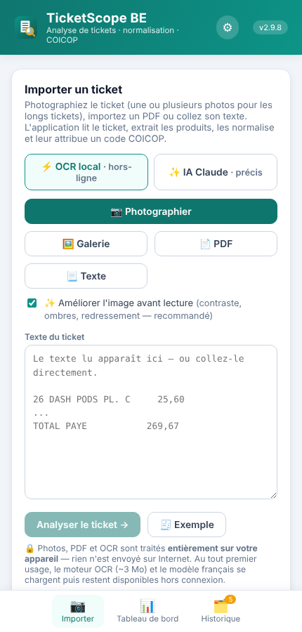
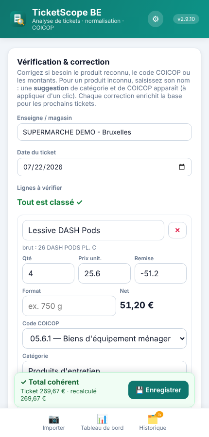
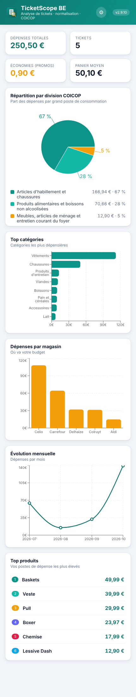
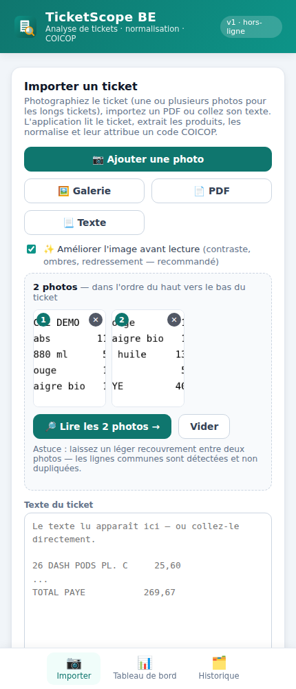

# TicketScope BE

Application web (PWA) d'analyse de tickets de caisse pour le marché belge :
importez un ticket, l'application **extrait les produits, les normalise, leur
attribue un code COICOP** avec un taux de confiance, puis produit des
**tableaux de bord** de dépenses et des **exports Excel / CSV / JSON**.

L'application est entièrement **côté client** (aucun backend) : le traitement se
fait dans le navigateur, les données restent sur l'appareil et l'application
fonctionne **hors connexion** une fois installée. Seule exception, le mode ✨ IA
en option, qui envoie l'image du ticket à l'API Anthropic (voir plus bas).

| Import | Correction & COICOP | Tableau de bord |
|:---:|:---:|:---:|
|  |  |  |

## Fonctionnalités

### Import
- 📷 **Photo (OCR)**, **PDF**, fichier `.txt` ou **copier-coller**. L'OCR image
  (Tesseract.js) et la lecture PDF (pdf.js) tournent **entièrement dans le
  navigateur** : aucune image n'est envoyée sur Internet. Les PDF « numériques »
  sont lus via leur texte intégré ; les PDF scannés passent par l'OCR.
- 🧵 **Multi-photo** pour les longs tickets : photographiez le ticket en
  plusieurs tranches (du haut vers le bas, avec un léger recouvrement). Chaque
  tranche est lue puis **recollée automatiquement**, sans dupliquer les lignes
  du recouvrement (`src/lib/stitch.js`).
- ✨ **Pré-traitement d'image** avant l'OCR (activable) : orientation EXIF,
  redimensionnement, niveaux de gris, suppression des ombres, contraste,
  débruitage et redressement (deskew). Un aperçu montre l'image « telle que vue
  par l'OCR ».
- ✨ **Mode IA (Claude Vision)**, en option — voir la section dédiée plus bas.

### Extraction et classification
- 🧠 **Extraction et normalisation** : enseigne, date (dates impossibles
  rejetées), produits, quantités (`4 × 25,60`, `2 x 1,50   3,00`), prix
  unitaires, promotions et remises rattachées à l'article ; les remises du
  récapitulatif ne sont pas comptées deux fois.
- 🏷️ **Classification COICOP 2018** avec **taux de confiance** et catégorie fine :
  alimentation et boissons non alcoolisées (01), alcool et tabac (02),
  **habillement et chaussures (03)**, maison et entretien (05), santé courante (06),
  carburants (07), restauration (11) et soins corporels (13). Trois niveaux :
  **dictionnaire de produits** (et corrections apprises), puis **repli par règles**
  de mots entiers (code pré-rempli mais toujours « à confirmer »), puis « non
  classé ». Les codes viennent d'un référentiel officiel versionné (voir
  *Référentiel COICOP*).
- 📏 **Format et prix unitaire normalisé** (€/kg, €/L, €/pièce), multipacks
  compris (`6 x 33 cl`).
- ✏️ **Écran de correction** : produit, **marque** (optionnelle : la marque du produit,
  ex. Dash, McCain ; pour un vêtement d'une enseigne mono-marque, l'enseigne ; sinon
  vide — elle est exportée dans la colonne `marque`), quantité, prix, remise, format,
  code COICOP, catégorie. Chaque correction **enrichit la base** (auto-apprentissage
  local). Les lignes « à confirmer » se filtrent d'un clic ; on peut ajouter une
  ligne manquante à la main. **Sur téléphone**, les lignes sont des **fiches**
  (champs étiquetés, sans défilement horizontal) et une **barre collante** au-dessus
  de la navigation affiche en permanence l'écart entre le total du ticket et le
  total recalculé, le nombre de lignes à confirmer et le bouton Enregistrer ; sur
  grand écran, le tableau est conservé.
- 🎯 **Deux confiances distinctes** par ligne : **lecture** (le libellé et les
  montants ont-ils été bien lus ? score par ligne de l'OCR Tesseract, ou
  certitude de l'IA) et **classement** (bon code COICOP ?). Une ligne est « à
  confirmer » si l'une des deux est faible ; modifier la ligne ou toucher
  « Lecture vérifiée » confirme la lecture. Un texte collé ou un PDF numérique n'a
  pas de score de lecture (texte exact).
- 🔎 **Contrôle de cohérence** : total recalculé vs total payé du ticket. Tous les
  calculs de montants passent par des **centimes entiers** (pas de bruit de virgule
  flottante, arrondi commercial au demi-centime) ; un écart d'un centime d'arrondi
  est toléré, au-delà le ticket reste signalé.

### Suivi et exports
- 📊 **Tableaux de bord** : dépenses par division COICOP, par catégorie, par
  magasin, évolution mensuelle, top produits, économies réalisées. Le tableau de
  bord est chargé à la demande pour garder un démarrage rapide.
- 🗂️ **Historique** : recherche instantanée (produit, catégorie, COICOP,
  magasin), **modification** d'un ticket enregistré et **comparaison de deux
  tickets** (par exemple le même ticket lu par l'IA et par l'OCR), avec
  correction directement dans la comparaison.
- ⬇️ **Exports** Excel (`.xlsx`, feuilles *Lignes* / *Synthèse COICOP* /
  *Tickets*), CSV et JSON, prêts pour Excel ou Power BI. La synthèse est regroupée
  **par code COICOP** ; chaque ligne porte le code, son libellé, la colonne
  `coicop_version` (référentiel utilisé) et `coicop_1999` (équivalent(s) dans
  l'ancienne nomenclature, séparés par « | »).
- 💾 **Sauvegarde complète** (tickets + dictionnaire appris, jamais la clé API)
  en un fichier `.json`, à restaurer sur un autre appareil. L'import est **strict
  et en deux temps** : le fichier est d'abord analysé (aperçu avec les anomalies,
  rien n'est écrit), puis importé seulement après votre confirmation. Les valeurs
  impossibles (texte dans un champ numérique, date inexistante, quantité
  négative…) font **rejeter** le ticket au lieu d'être corrigées en silence ; les
  tickets déjà présents ne sont jamais écrasés ; les anciens exports JSON des
  tickets et l'export du dictionnaire sont acceptés. Un **rappel** s'affiche
  quand aucune sauvegarde n'a été exportée depuis 30 jours (les sauvegardes
  restent manuelles). Un code COICOP inconnu du référentiel est conservé mais
  signalé ; l'ancien code `02.1.2` « Boissons sans alcool » est migré vers `01.2.9`
  (à confirmer).

  
- 📱 **PWA** installable sur Android, iPhone, Windows, Mac ; fonctionne hors
  ligne (portrait et paysage).

## Mode IA (Claude Vision)

Au lieu de l'OCR local, la photo (ou le PDF) est lue par **Claude**, qui extrait,
normalise et classe les produits en un seul appel, avec une réponse JSON
structurée. C'est nettement plus précis sur les photos difficiles.

- **Modèles** (Réglages ⚙) : **Haiku 4.5** par défaut (rapide, économique),
  Haiku 5.5, Sonnet 5 et Sonnet 5.5 en option. Haiku 5.5 et Sonnet 5.5 sont
  encore à valider sur de vrais tickets.
- **BYOK** : vous utilisez **votre propre clé API Anthropic** (créez-la sur
  console.anthropic.com, avec une limite de dépense). Elle est **chiffrée sur
  l'appareil** (voir *Vie privée et sécurité*) et n'est envoyée qu'à l'API
  Anthropic.
- **Vie privée** : en mode IA, l'image du ticket **quitte l'appareil**. L'OCR
  local reste le mode par défaut, 100 % hors ligne.
- **Promotions de lot** (`Boxers 3 x 19,99EUR = -3,98`) : gardées comme **une
  ligne négative** dans la liste, avec le code COICOP des articles concernés,
  pour que le total reste exact. Une remise supérieure au prix de la ligne est
  marquée « à confirmer ».
- **Codes COICOP** : la réponse est contrainte aux classes du référentiel (le
  schéma JSON les énumère) ; un code qui n'y figure pas devient « non classé »,
  à relire. Les sous-vêtements sont des vêtements (`03.1.2`), les boissons sans
  alcool sont en `01.2.x`.
- **Erreurs** : délai de 90 s, nouvelles tentatives sur 429/529, messages
  explicites (clé invalide, limite de débit, ticket trop long, lecture vide avec
  le détail de la réponse de l'API).

## Démarrage

Prérequis : **Node.js 24.x** (champ `engines` de `package.json`).

```bash
npm install
npm run dev        # serveur de développement (http://localhost:5173)
npm run build      # build de production dans dist/
npm run preview    # sert le build de production
npm test           # tests unitaires (Vitest)
npm run e2e        # tests de bout en bout sur téléphone émulé (Playwright)
npm run eval       # précision du pipeline local sur un jeu de tickets annotés
```

Les tests de bout en bout construisent l'application, la servent avec les en-têtes
de `vercel.json` et la pilotent dans Chromium (Pixel 7). Premier lancement :
`npx playwright install chromium` ; `PW_CHROMIUM=/chemin/vers/chrome` permet
d'utiliser un Chromium déjà installé.

Pour l'essayer immédiatement : ouvrez l'application, cliquez sur
**« Exemple »**, puis **« Analyser le ticket »**.

## Déploiement (Vercel)

Le dépôt est prêt pour **Vercel** (config dans `vercel.json`) — aucun réglage
manuel à saisir :

1. Sur [vercel.com](https://vercel.com) → **Add New… → Project**.
2. **Import Git Repository** → choisissez ce dépôt GitHub.
3. Vercel détecte le framework **Vite** et lit `vercel.json` :
   - *Build Command* : `npm run build` (copie les fichiers OCR puis build Vite) ;
   - *Output Directory* : `dist` ;
   - réécriture SPA (`/* → /index.html`) et cache correct du *service worker* ;
   - en-têtes de sécurité, dont une **Content-Security-Policy** (scripts de
     l'application uniquement ; connexions limitées à l'application et à
     `api.anthropic.com`).
4. **Version de Node** : celle de `engines` (24.x). Vercel a abandonné Node 20 ;
   si le build échoue sur ce point, vérifiez aussi *Settings → General → Node.js
   Version*.
5. **Branche de production** : `main` (*Settings → Git → Production Branch*) ;
   chaque fusion sur `main` déploie en production, chaque autre branche produit
   un déploiement de prévisualisation. Le badge de version de l'application
   (`package.json`) permet de vérifier ce qui est en ligne.

> Le mode ✨ IA est **BYOK** : la clé API reste sur l'appareil de l'utilisateur
> (aucune variable d'environnement à configurer sur Vercel).

L'intégration continue (`.github/workflows/ci.yml`) lance, à chaque push et pull
request, les tests unitaires et le build, ainsi que les tests de bout en bout
(rapport Playwright conservé en cas d'échec).

## Architecture

```
src/
  App.jsx            Navigation, état global (tickets, réglages IA, clé API en mémoire)
  data/
    coicop.js        Référentiel COICOP 2018 : version, validation, libellés FR, migration
    coicop2018.js    Structure officielle (264 codes : divisions, groupes, classes ; en + fr)
    coicop1999.js    COICOP 1999 et paires de correspondance 1999 ↔ 2018 (tableau ONU)
    coicopCorrespondence.js  from1999() / to1999() : équivalents entre les deux nomenclatures
    dictionary.js    Base de connaissances produits (libellés bruts → COICOP)
    sampleTicket.js  Ticket de démonstration
  lib/
    format.js        Normalisation de texte (hasWord : mots entiers), parsing strict des montants, formats € / dates
    money.js         Calculs monétaires en centimes entiers (somme, produit, écart, arrondi)
    parser.js        Texte du ticket → enseigne, date, lignes, totaux
    classifier.js    Ligne → produit normalisé + COICOP + confiance (tolérant aux fautes OCR)
    suggest.js       Suggestion COICOP à partir du nom saisi (dictionnaire + règles)
    units.js         Format (poids, volume, pièces, multipacks) et prix unitaire
    imagePrep.js     Pré-traitement image (ombres, contraste, deskew) avant OCR
    ocr.js           OCR image (Tesseract.js) + lecture PDF (pdf.js) → texte
    stitch.js        Recollage de plusieurs photos d'un long ticket
    claudeVision.js  Mode IA : lecture par Claude (vision) → JSON structuré → brouillon
    compare.js       Comparaison de deux tickets (appariement flou des lignes)
    ticketStore.js   Tickets enregistrés (IndexedDB, repli localStorage, migration)
    secretStore.js   Clé API Anthropic chiffrée (WebCrypto, clé d'appareil non exportable)
    storage.js       Base apprise et réglages (localStorage)
    review.js        Logique pure de l'écran de correction (à confirmer, totaux, écart)
    readConfidence.js Confiance de lecture par ligne (scores OCR rattachés aux lignes)
    useMediaQuery.js Hook : fiches (téléphone) ou tableau (grand écran)
    backup.js        Sauvegarde / restauration : validation stricte, plan d'import, rappel
    saveFlow.js      Enregistrement d'un ticket corrigé : ticket d'abord, apprentissage ensuite
    exporters.js     Exports Excel / CSV / JSON (colonnes coicop_version, coicop_1999)
    xlsxWriter.js    Écriture .xlsx maison (sans dépendance de lecture)
    *.test.js        Tests unitaires de chaque module (aussi dans data/)
  components/        Interface React (Import, Correction — tableau et fiches —,
                     Tableau de bord, Historique, Comparaison, Réglages)
e2e/                 Tests de bout en bout (Playwright, téléphone émulé)
eval/                Jeu de tickets annotés et suivi de précision (npm run eval)
playwright.config.js Configuration des tests de bout en bout
scripts/
  prepare-ocr.mjs    Copie le moteur Tesseract (worker + WASM) dans public/tesseract/
public/tesseract/    Actifs OCR servis localement (aucun CDN) ; lang/ = modèle FR
```

Le **parseur est découplé de la source d'entrée** (`ocr.js` → texte →
`parseTicket()`), ce qui permet d'ajouter d'autres sources sans toucher au reste ;
le mode IA produit directement le même brouillon que l'écran de correction.

### OCR & lecture PDF (100 % local)

- **Images** : `Tesseract.js` (WebAssembly). Le worker et le cœur WASM sont
  copiés depuis `node_modules` par `scripts/prepare-ocr.mjs` (lancé avant
  `dev`/`build`) et servis depuis `public/tesseract/`. Le modèle français
  `lang/fra.traineddata.gz` est versionné dans le dépôt.
- **Pré-traitement** (`imagePrep.js`) : orientation EXIF, éclairage/ombres via
  division par le fond, contraste, débruitage, redressement. Désactivable via
  une case à cocher.
- **PDF** : `pdf.js` lit d'abord le texte intégré (PDF numérique) ; si la page
  est scannée, elle est rendue en image, pré-traitée, puis passée à l'OCR.
- **Multi-photo** (`stitch.js`) : chaque photo est lue séparément, puis les
  textes sont recollés en détectant les lignes communes au recouvrement
  (similarité de Dice sur bigrammes).
- Le service worker met ces actifs en cache à la première utilisation
  (`runtimeCaching`), de sorte que l'OCR fonctionne ensuite **hors connexion**.



### Base de connaissances & classement

La base produits (`src/data/dictionary.js`) est dérivée du jeu de référence
`ticket_proxy_coicop.xlsx`. Chaque entrée relie des **libellés bruts** (souvent
abrégés sur les tickets) à un **produit normalisé**, une **marque**, un **code
COICOP** et une **catégorie**. Le classement local procède par ordre :

1. **corrections apprises** (stockées localement, prioritaires) : exactes à 99 %,
   approximatives (faute OCR) proposées « à confirmer » ;
2. **dictionnaire** : correspondance de **mots entiers** (« lait » ne matche pas
   « laitue »), tolérante aux fautes OCR (alors « à confirmer ») ;
3. **repli par règles** génériques (`suggest.js` : chemise, café, vin, sauce…) :
   confiance 60 % ou 50 %, toujours « à confirmer », mention « 💡 par règle » ;
4. sinon **« non classé »** (25 %), à classer à la main.

En mode IA, la liste des codes du référentiel est imposée au modèle.

### Référentiel COICOP

Nomenclature **COICOP 2018** (celle de l'ECOICOP version 2 que l'IPCH adopte depuis
janvier 2026), versionnée dans `src/data/` :

| Fichier | Contenu | Source |
|---|---|---|
| `coicop2018.js` | 15 divisions, 63 groupes, 186 classes ; titres anglais et français | ONU (`COICOP_2018_English_structure.xlsx`) pour la structure et l'anglais ; Eurostat (`ESTAT:COICOP18` 3.2) pour le français. Les deux concordent sur les 264 codes. |
| `coicop1999.js` | COICOP 1999 et 286 paires de correspondance avec la 2018 | ONU, tableau de correspondance du 2 octobre 2024 |

L'empreinte SHA-256 de chaque fichier source est consignée dans les données.
Règles de conduite :

- **41 classes proposées** dans l'interface et au mode IA (`ACTIVE` dans
  `coicop.js`) ; les autres codes officiels restent reconnus (import, export).
- **Jamais de code inconnu présenté comme officiel** : un code hors référentiel est
  « non classé » en mode IA et signalé à l'import des sauvegardes.
- **Pas de reclassement silencieux** : un changement de sens d'un ancien code passe
  par `COICOP_LEGACY_MIGRATIONS` (ancien code conservé dans `coicopLegacy`, ligne « à
  confirmer »). Seul cas à ce jour : `02.1.2` « Boissons sans alcool » (en 2018,
  `02.1.2` est le vin) → `01.2.9`. Les 16 autres anciens codes gardent leur place.
- **Correspondance** : `from1999()` et `to1999()` renvoient toutes les cibles (une
  classe peut se répartir sur plusieurs), jamais un choix silencieux.
- Les suffixes de durabilité « (ND) », « (SD) »… sont conservés dans les données et
  masqués à l'affichage. Les libellés **néerlandais** ne sont pas encore intégrés
  (Statbel).

Étendre les classes proposées : ajouter le code à `ACTIVE` (le libellé vient du
référentiel). Changer d'édition : régénérer `coicop2018.js` depuis les nouveaux
fichiers officiels et écrire la migration des anciens codes.

### Suivi de précision (`npm run eval`)

`eval/` contient un jeu de tickets annotés et un script qui mesure ce que le
pipeline **local** fait d'un texte de ticket, avec 0 / 3 / 6 % de bruit de type
OCR : lignes retrouvées, montants exacts, bon code COICOP, couverture, erreurs
signalées « à confirmer » et **calibration de la confiance**. `npm test` rejoue ces
mesures avec des seuils (« cliquet ») : une régression fait échouer les tests.

Mesures actuelles (codes COICOP 2018) : lignes et montants retrouvés à 100 % jusqu'à
6 % de bruit ; sans bruit, **100 % de couverture** et **100 % de bons codes** sur les cinq
tickets (91 lignes) ; avec 6 % de bruit, 69 % de bons codes et toutes les erreurs signalées « à
confirmer ». Ce 100 % est à relativiser : le dictionnaire, les règles et les références de
l'évaluation ont été alignés sur le même texte officiel par la même personne (voir 2.9.12) ;
c'est un garde-fou contre les régressions, pas une mesure de la justesse sur de vrais tickets.
Les deux tickets synthétiques des classes ajoutées (santé, maison, carburant, restauration) sont
annotés par l'auteur des règles. Limite connue : le classement local ignore l'enseigne, donc une
bière au restaurant reste classée en bière (`02.1.3`) et non en restauration (`11.1.1`). Les codes de référence du ticket d'exemple viennent de
l'IA et **ne sont pas validés par un humain** (voir `eval/README.md`).

## Vie privée et sécurité

- **Aucun serveur** : tickets, produits et corrections restent dans le
  navigateur de l'appareil. L'OCR local n'envoie rien sur Internet ; seul le
  mode IA envoie l'image du ticket à l'API Anthropic.
- **Stockage** : les tickets sont dans **IndexedDB** (migrés automatiquement
  depuis l'ancien `localStorage`, avec repli sur `localStorage` si IndexedDB est
  indisponible). La migration est **idempotente** : elle n'écrase jamais un ticket
  déjà présent et ne ressuscite pas un ticket supprimé, même si l'ancienne clé n'a
  pas pu être effacée. La base apprise et les réglages sont dans `localStorage`.
- **Clé API Anthropic** : chiffrée (AES-GCM) avec une **clé d'appareil non
  exportable** (WebCrypto), dans une base IndexedDB à part ; migrée
  automatiquement depuis l'ancien stockage en clair — l'ancienne copie n'est
  supprimée qu'après avoir été chiffrée **et relue**. Elle n'apparaît jamais dans
  les sauvegardes. **Mode dégradé** (sans WebCrypto ou IndexedDB, ou stockage
  plein) : la clé n'est **jamais écrite en clair** ; elle reste en mémoire pour la
  session, les Réglages l'indiquent et il faudra la ressaisir. Limite : un script
  malveillant exécuté dans la page pourrait demander le déchiffrement ; la CSP
  réduit ce risque sans l'éliminer.
- **Exports** : les libellés commençant par `=`, `+`, `-` ou `@` sont neutralisés
  pour éviter l'injection de formule à l'ouverture dans Excel.
- **Dépendances** : l'export Excel n'utilise plus la librairie `xlsx` (avis de
  sécurité sans correctif sur npm) mais un écrivain `.xlsx` maison
  (`xlsxWriter.js`, compression `fflate`). Les outils de développement (Vite 7,
  Vitest 5, plugins PWA et React à jour) sont aussi à jour : `npm audit` ne
  signale aucune vulnérabilité, y compris pour les dépendances de développement.
- **Instructions au modèle IA** : l'invariant de total est
  somme(lignes) + somme(promotions) = total payé ; les remises globales du
  récapitulatif passent par les promotions au lieu d'être ignorées.

## Nouveautés récentes

- **3.1.2** — **date du ticket en mode IA** : la consigne précise que les tickets belges s’écrivent jour/mois/année (« 08/10/26 » = 8 octobre, et non 10 août) et de laisser la date vide si un chiffre est illisible, plutôt que de deviner.
- **3.1.1** — correction : dans « Produits par catégorie » (parcours famille), les noms de catégories s’affichaient « ?? » (emoji coupé en deux) ; ils affichent maintenant l’emoji et le libellé simple.
- **3.1.0** — **produits par catégorie** : dans l’Historique, une vue de tous les produits de tous les tickets, rangés par catégorie, « Non classé » en premier. On corrige une ligne ou plusieurs d’un coup (cases à cocher) ; la correction est enregistrée dans le ticket et mémorisée pour les prochains. Disponible dans le parcours famille (catégories en mots simples) comme en mode avancé.
- **3.0.2** — **fleurs et eaux** : nouvelle classe `09.3.1` (fleurs, bouquets, plantes, terreau) ; l’eau est reconnue sous toutes ses écritures (minéralisée, de source, marques Spa, Vittel, Evian…) ; l’eau déminéralisée ou distillée (fer à repasser) va en `05.6.1`, pas en boisson. 41 classes proposées.
- **3.0.1** — **arrondi de caisse** : une ligne « Liquide arrondi » (espèces arrondies aux 5 centimes) n’est plus prise pour le total du ticket (consigne IA + analyse locale), et un écart de 1 à 2 centimes est accepté comme cohérent.
- **3.0.0** — **parcours « famille » par défaut** : un seul geste pour importer (📷 Photographier), une vérification
  réduite au total et aux seuls articles à vérifier, avec des catégories aux noms courants (sans code COICOP),
  puis un export Excel/CSV à envoyer à l'organisateur de l'enquête. Codes, trois modes d'affichage, IA,
  reclassement en masse, dictionnaire et sauvegardes passent dans **Réglages → Mode avancé**.
- **2.11.0** — **reclassement en masse** des anciens tickets (Historique → « Reclasser les anciens tickets ») :
  aperçu ligne par ligne, rien n'est écrit avant confirmation ; applique le dictionnaire et les corrections
  apprises aux codes douteux, et une règle aux lignes sans code (qui restent « à confirmer »). Les lignes
  corrigées ou ajoutées à la main ne sont jamais touchées.
- **2.10.0** — écran de correction pour les **longs tickets** : trois modes (*Simplifié* : une ligne par
  article, ouvert par défaut au-delà de 10 lignes ; *Détaillé* ; *Contrôle des codes* : lignes groupées par
  code, avec reclassement de plusieurs lignes d'un coup) et un **sélecteur de classe avec recherche**
  (code, titre ou mot-clé de produit, classes suggérées et déjà présentes dans le ticket en tête).
- **2.9.13** — nouvelle classe **`04.3.1` Matériaux et fournitures de bricolage** (bonde, siphon, profilés,
  peinture, enduit, mastic, chevilles, tuyaux, serrures…) : règle de repli et consigne au mode IA ;
  les outils à main restent en `05.5.2`. 41 classes proposées.
- **2.9.12** — classement alimentaire corrigé d'après le **texte officiel de la COICOP 2018**,
  à partir d'un export réel : l'IA, quand elle hésitait, tombait sur le premier code de la liste
  (« Pain et céréales », `01.1.1`) pour des quiches, des nouilles préparées, des olives ou un
  américain préparé. (1) **Mode IA** : consignes précisées par famille de produits et défense de
  prendre `01.1.1` par défaut ; (2) **dictionnaire sûr prioritaire** sur les lignes douteuses de
  l'IA (`reconcileWithLocal`), automatiquement à l'import IA et par le bouton **« ↻ Revérifier avec
  le dictionnaire »** de l'écran de correction (jamais sur une ligne que vous avez corrigée) ;
  (3) **dictionnaire et règles recodés** quand le texte officiel contredisait : biscuits, gâteaux,
  éclairs, gaufres et céréales de petit-déjeuner sont des produits de boulangerie (`01.1.1`), pas
  de la confiserie ; chips et frites surgelées en `01.1.7` ; gazpacho et soupes en `01.1.9` ;
  tarama en `01.1.3` ; grissini et ravioli frais en `01.1.1`.
- **2.9.11** — d'après une sauvegarde réelle : **apprentissage plus prudent** (corriger
  seulement le nom d'une ligne dont le code est douteux n'apprend plus ce code ; seule une
  classification choisie ou déjà sûre est mémorisée) ; **suggestion de code** aussi pour une
  ligne au code douteux (ex. « Lacet… » proposé en `03.2.1` au lieu de `01.1.4`) ; champ
  **Marque** éditable sur chaque ligne ; promotions de lot : le calcul (somme des articles =
  prix du lot + remise) **corrige les articles visés** quand le modèle se trompe, et
  « Boxer's » n'est plus lu « Boxer' » ; lacets et semelles en `03.2.1`, cirage en `05.6.1`,
  réparation de chaussures en `03.2.2`.
- **2.9.10** — tableau de bord : le camembert « Répartition par division COICOP » n'affiche
  plus que des pourcentages ; une **légende** donne le nom complet de chaque division, son
  montant et sa part (les noms longs étaient tronqués au premier mot sur téléphone).
- **2.9.9** — **11 classes COICOP de plus** (39 au total) : restaurants et cafés `11.1.1`,
  cantines `11.1.2`, linge de maison `05.2.1`, petits appareils `05.3.2`, vaisselle et
  ustensiles `05.4.0`, outillage non motorisé `05.5.2`, médicaments `06.1.1`, produits
  médicaux `06.1.2`, soins corporels `13.1.2`, coiffure et beauté `13.1.3`, carburants
  `07.2.2`. Règles de mots entiers tirées du texte officiel de chaque classe (papier
  toilette et mouchoirs sont en `13.1.2`, pas en produits ménagers). Une correspondance
  **approximative** du dictionnaire (« homme » ~ « pomme ») cède désormais la place à une
  règle précise. Deux tickets synthétiques ajoutés à l'évaluation.
- **2.9.8** — **correspondance COICOP 1999 ↔ 2018** (`src/data/coicop1999.js` et
  `coicopCorrespondence.js`), d'après le tableau officiel de l'ONU (2 octobre 2024,
  empreinte SHA-256 consignée) : titres 1999 et équivalents dans les deux sens. Une classe
  peut se répartir sur plusieurs : toutes les cibles sont renvoyées, jamais un choix
  silencieux. Les exports ont une colonne `coicop_1999` (équivalents de l'ancienne
  nomenclature, séparés par « | »), utile pour comparer à des statistiques qui n'ont pas
  migré. **Tickets déjà enregistrés** : 16 des 17 anciens codes de l'application gardent
  leur place en 2018 (leur cible principale est eux-mêmes) ; le 17e (`02.1.2` « Boissons
  sans alcool », propre à l'application) est déjà migré depuis la 2.9.6.
- **2.9.7** — **libellés français officiels** de la COICOP 2018 : titres issus de la liste
  de codes Eurostat `ESTAT:COICOP18` 3.2 (fichier `ESTAT_COICOP18_3.2.xml.gz`), qui
  concordent avec la structure de l'ONU sur les 264 codes (divisions, groupes, classes) ;
  ils remplacent la traduction du projet. Les **13 divisions** des ménages (01 à 13) sont
  disponibles pour le tableau de bord. Le suffixe de durabilité « (ND) », « (SD) »… est
  masqué à l'affichage. Pas encore de titres néerlandais (Statbel).
- **2.9.6** — **référentiel COICOP 2018 officiel** (`src/data/coicop2018.js`, extrait
  du fichier `COICOP_2018_English_structure.xlsx`, empreinte SHA-256 incluse) :
  15 divisions, 63 groupes, 186 classes ; version, source et fonctions de validation
  (`src/data/coicop.js`). Libellés français : voir 2.9.7. Les classes
  proposées passent de 17 à 28 (boissons sans alcool `01.2.x`, vin/bière/spiritueux
  `02.1.x`, tabac). **Correction** : `02.1.2` est le **vin** ; les boissons sans
  alcool sont en `01.2.x` (café `01.2.2`, eau `01.2.5`, sodas `01.2.6`, jus
  `01.2.1`) ; sauces et condiments en `01.1.9`. Les anciens tickets et sauvegardes
  qui portaient `02.1.2` « Boissons sans alcool » sont migrés vers `01.2.9` (à
  confirmer, ancien code conservé dans `coicopLegacy`). Un code inconnu du mode IA
  devient « non classé » ; les exports ajoutent la colonne `coicop_version`.
- **2.9.5** — **calculs en centimes** (`src/lib/money.js`) : sommes, écarts, totaux
  et rapprochement du ticket passent par des centimes entiers (plus de bruit de
  virgule flottante, arrondi commercial au demi-centime : 0,5 kg × 0,99 € = 0,50 €).
  Les montants restent stockés en euros : tickets, sauvegardes et exports existants
  sont inchangés.
- **2.9.4** — classement local plus prudent (audit du 18/10) : les mots-clés
  s'appliquent à des **mots entiers** (« lait » ne matche plus « laitue ») ; une
  correspondance **apprise approximative** (faute OCR) n'est plus à 99 % : elle est
  proposée « à confirmer » ; `parseAmount` **rejette** les montants malformés
  (« 12,5abc », « 12-34 ») au lieu de les arrondir.
- **2.9.3** — mode IA : le type d'article d'une promotion de lot (« Boxers 3 x … ») n'est
  appliqué qu'aux articles visés ; les autres reprennent leur nom de modèle, même si
  le modèle a étendu « Boxer » à tout le ticket.
- **2.9.2** — mode IA : consigne corrigée pour ne plus nommer tous les articles d'après
  une promotion de lot (« Boxers 3 x 19,99EUR ») ni recopier son prix sur un article.
- **2.9.1** — la feuille *Synthèse COICOP* de l'export Excel est regroupée **par code**
  (une ligne par code ; les catégories distinctes sont réunies avec « / »).
- **2.9** — **repli par règles** pour le classement local : un produit absent du
  dictionnaire est classé par les règles génériques (vêtements, chaussures,
  alimentation…), toujours « à confirmer » (confiance 60 % ou 50 %, mention
  « 💡 par règle ») ; le dictionnaire et les corrections apprises restent
  prioritaires.
- **2.8** — écran de correction en **fiches sur téléphone** avec barre d'écart
  collante ; **confiance de lecture** séparée de la confiance de classement
  (OCR, IA, export, sauvegarde) ; **suivi de précision** sur un jeu annoté
  (`npm run eval`) ; tests de bout en bout des fiches et de la **mise à jour du
  service worker** ; lacets et semelles suggèrent les chaussures.
- **2.7.1** — corrections issues de la revue de code : migration des tickets
  idempotente ; clé API jamais écrite en clair (mode dégradé en mémoire, erreurs
  signalées, ancienne clé supprimée seulement après confirmation) ; import des
  sauvegardes strict avec aperçu et confirmation ; consigne de total cohérente avec
  les promotions ; vrac « au litre » en volume ; ticket enregistré avant
  l'apprentissage ; rappel de sauvegarde ; tests de bout en bout sur téléphone en
  CI ; outils de développement à jour (0 vulnérabilité) ; captures d'écran
  régénérées.
- **2.7** — sauvegarde / restauration complète ; export Excel sans la dépendance
  `xlsx` vulnérable.
- **2.6** — Node 24 ; tickets dans IndexedDB ; clé API chiffrée ; codes COICOP
  habillement ; promotions de lot en ligne négative ; correctifs du parseur et
  des formats ; chargement à la demande du tableau de bord ; CSP et intégration
  continue.

## Feuille de route

- **V1** — import texte, extraction, classification COICOP, correction,
  tableaux de bord, exports, PWA hors-ligne.
- **V2 (version actuelle, 2.9)** — import **photo (OCR) / PDF**, pré-traitement
  d'image, capture multi-photo, **mode IA (Claude Vision)**, comparaison de
  tickets, prix unitaires, sauvegarde complète, **référentiel COICOP 2018
  officiel** avec correspondance 1999.
- **Prochaines étapes** — libellés **néerlandais** (Statbel) et classes COICOP
  supplémentaires (restauration, services, transports, télécommunications) après
  validation des codes et des règles contextuelles.
- **V3** — apprentissage automatique avancé, comparateur de prix entre
  enseignes, synchronisation cloud, modèles OCR multilingues, scan de
  codes-barres (EAN), intégration bancaire, listes de courses, alertes prix,
  suivi nutritionnel et empreinte carbone, *Data Explorer* façon Power BI
  (tableaux croisés, requêtes en langage naturel).
